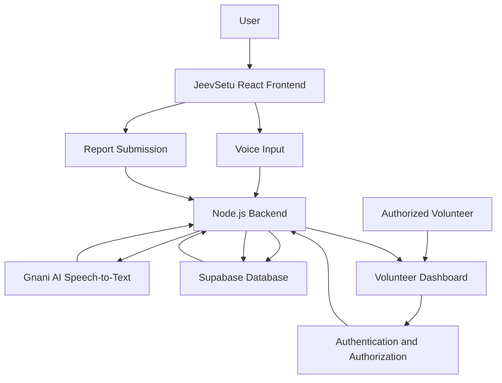
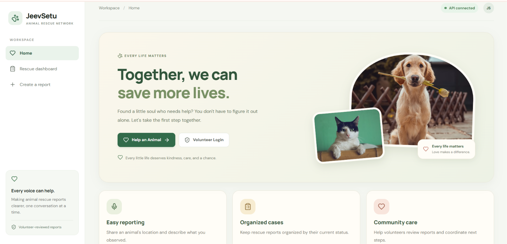
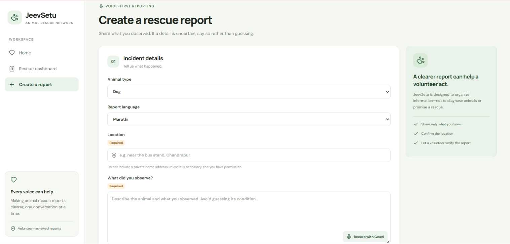
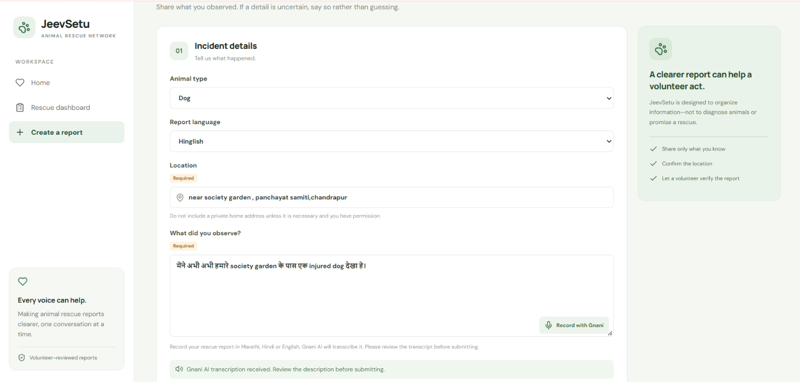
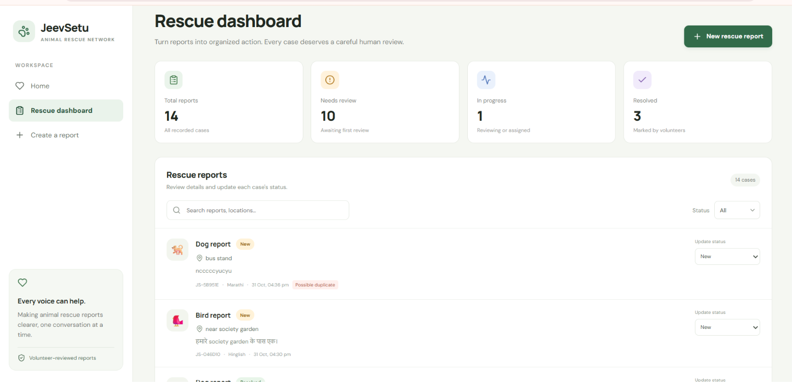

# 🐾 JeevSetu – AI-Powered Animal Rescue Reporting & Volunteer Coordination Platform

**Giving every animal a better chance through accessible reporting, organized case management, and technology.**

🌐 **Live Website:** https://jeevsetu.vercel.app  
⚙️ **Backend API:** https://jeevsetu-backend-g5yx.onrender.com  
💻 **GitHub Repository:** https://github.com/raningashrushti/Jeevsetu

---

## 📌 About the Project

JeevSetu is an AI-powered animal rescue reporting and volunteer coordination platform designed to make reporting animal-related emergencies and managing rescue cases more organized and accessible.

When someone comes across an injured, abandoned, or distressed animal, reporting the situation and connecting with people who can help may not always be straightforward. At the same time, animal welfare volunteers often manage rescue activities alongside their professional and personal responsibilities.

JeevSetu aims to bridge this gap by providing a centralized platform where people can submit animal rescue reports, including through voice-based reporting, while authorized volunteers can review reports, manage cases, and track their progress.

The goal is to use technology to make animal rescue reporting more convenient and volunteer coordination more structured.

---

## ❗ Problem Statement

Animal rescue efforts often face practical challenges:

- People may not know whom to contact when they find an animal that needs help.
- Volunteers may not always be available to answer calls immediately.
- Some volunteers may be working professionals who manage animal welfare activities alongside their jobs and other responsibilities.
- People reporting an incident may find it difficult to type a detailed description, especially when they are at the location.
- Information about different rescue cases can become scattered across calls and individual conversations.
- Volunteers may find it difficult to maintain a proper record of reported cases and track their progress.

These challenges highlight the need for a simple, centralized system that supports reporting and helps volunteers organize their work.

---

## 💡 Why JeevSetu? Why Not Just Call a Volunteer?

Directly calling a volunteer is certainly a valid and important way to communicate during an animal rescue situation. JeevSetu is not designed to replace direct calls or personal communication.

However, relying only on calls can create practical difficulties.

**1. Volunteers may not always be available**

Many animal welfare volunteers are working professionals. They contribute to animal welfare as a social responsibility while also managing their jobs and personal commitments. They may not always be able to answer a call immediately.

**2. Unknown calls may go unanswered**

People may hesitate to call back unknown numbers, and a volunteer may miss a call while occupied with another responsibility.

**3. Rescue cases need proper tracking**

A volunteer may encounter several animal-related cases. Keeping track of each case, its reported details, location, current status, and progress can become difficult without a centralized record.

**4. Reports can be reviewed when volunteers become available**

JeevSetu provides a place where people can submit reports even when a volunteer is not immediately available. Authorized volunteers can review the submitted information when they are able to access the platform.

**5. A centralized record supports better organization**

Instead of depending only on separate calls and conversations, reports can be maintained in one system and their status can be updated as the case progresses.

**Our approach:** JeevSetu complements direct communication by providing a structured reporting and case-management system. It does not replace emergency services, urgent calls, or direct coordination when immediate communication is needed.

---

## 🚀 Our Solution

JeevSetu provides a centralized platform with two main workflows:

### For People Reporting an Animal in Need

- Submit an animal rescue report through the website.
- Provide details about the animal and the situation.
- Use voice-based reporting to describe the situation instead of relying entirely on typing.
- Submit the report so that it can be accessed by authorized volunteers.

### For Authorized Volunteers

- Access the volunteer dashboard.
- View submitted animal rescue reports.
- Review the available case details.
- Track reports through different statuses.
- Update a case status as the work progresses.

This creates a more organized way to collect reports and manage rescue-related information.

---

## ✨ Key Features

### 1. Animal Rescue Report Submission

People can submit reports about animals that may need assistance.

Reports can include:
- Animal type
- Description of the situation
- Location and other available report details
- Additional information provided through the reporting form

### 2. AI-Powered Voice Reporting with Gnani AI

Typing a detailed report may be difficult when someone is at the location of an animal that needs help.

JeevSetu integrates **Gnani AI Speech-to-Text** to support voice-based reporting. Users can speak their observations in a language available in the application, and the audio is processed into text that can be used in the report.

This feature aims to:
- Reduce the effort involved in typing a detailed description.
- Make reporting more convenient at the incident location.
- Help people explain what they observe in a more natural way.
- Support users who find speaking easier than typing.

### 3. Volunteer Authentication

The platform includes volunteer authentication so that access to volunteer-specific functionality is restricted to authorized users.

### 4. Volunteer Dashboard

Authorized volunteers can access a centralized dashboard to view submitted reports and review the available case information.

### 5. Case Status Management

Volunteers can update the status of reports to reflect their progress.

The available statuses are:

| Status | Meaning |
|---|---|
| New | A report has been submitted. |
| Reviewing | The report is being reviewed. |
| Assigned | The case has been assigned for follow-up. |
| Resolved | The case has been marked as resolved. |

### 6. Centralized Report Management

Reports are stored in a centralized database, making it easier for authorized volunteers to access and manage case information.

### 7. Responsive Web Experience

The platform is designed as a web application so that users can access its reporting and volunteer features through a browser.

---

## 🌟 Why Gnani AI? The Importance of Voice-Based Reporting

One of the important features of JeevSetu is its integration with Gnani AI.

Imagine someone reaching a location where an animal needs help. They may need to explain what happened, describe the animal's condition, and provide other relevant details. Typing all this information at that moment may be inconvenient.

This is where voice-based reporting becomes useful.

Instead of depending entirely on written descriptions, users can speak their observations in a language supported by the application. Gnani AI processes the audio and converts speech into text that can be used in the report.

**Why this matters:**

- Speaking can be more convenient than typing a long description.
- Users can explain their observations more naturally.
- Voice-based input can make the reporting process more accessible.
- It introduces a practical use of AI to solve a real-world usability problem.

Gnani AI is not included just to add an AI feature to the project. It is integrated to address a specific challenge in the reporting experience.

---

## 🔄 How JeevSetu Works

1. **Visit the platform:** A user opens the JeevSetu website.
2. **Report an animal in need:** The user enters the available details in the reporting form.
3. **Use voice reporting if preferred:** The user can provide a spoken description through the Gnani AI speech-to-text integration.
4. **Process the report:** The backend processes the request and stores the report in the database.
5. **Volunteer accesses the dashboard:** An authorized volunteer signs in and views the submitted reports.
6. **Review and manage the case:** The volunteer reviews the available details and updates the report status as appropriate.
7. **Track progress:** The updated status remains available in the system.

---

## 🏗️ System Architecture

JeevSetu follows a frontend–backend architecture with database and AI service integration.



### Architecture Overview

- **Frontend:** Provides the reporting interface and volunteer dashboard.
- **Backend:** Handles API requests, report processing, authentication checks, and communication with external services.
- **Database:** Stores animal rescue reports and their status.
- **Authentication:** Supports volunteer sign-in and authorization checks.
- **AI Integration:** Uses Gnani AI for speech-to-text processing.

---

## 🛠️ Technology Stack

| Technology | Purpose |
|---|---|
| React.js | Frontend user interface |
| Vite | Frontend development and build tool |
| Node.js | Backend runtime |
| Express.js | Backend API framework |
| Supabase | Database and authentication services |
| PostgreSQL | Relational database |
| Gnani AI | Speech-to-text integration |
| Multer | Audio file upload handling |
| Helmet | HTTP security-related middleware |
| Morgan | HTTP request logging |
| Vercel | Frontend deployment |
| Render | Backend deployment |
| Git & GitHub | Version control and source-code management |

---

## 🤖 AI Integration – Gnani AI Speech-to-Text

JeevSetu integrates the Gnani AI Speech-to-Text API to convert spoken descriptions into text.

### Voice Reporting Workflow

1. The user provides audio through the reporting interface.
2. The audio is sent to the Node.js backend.
3. The backend communicates with the Gnani AI Speech-to-Text API.
4. Gnani AI processes the audio and returns recognized text.
5. The backend makes the transcription available to the reporting workflow.

The integration uses a server-side API key so that the credential is not exposed in the frontend application.

**Purpose of the integration:** To make it easier for users to provide detailed animal rescue information through speech rather than relying only on manual typing.

---

## 🔐 Security and Data Handling

Security is an important part of JeevSetu's implementation.

- Volunteer-specific functionality is protected through authentication and server-side authorization checks.
- Access to volunteer dashboard operations is restricted to authorized volunteer accounts.
- Volunteer access is controlled using a configured email allowlist.
- Supabase credentials and the Gnani AI API key are maintained as environment variables.
- Secret credentials are not intended to be exposed in frontend code.
- Backend middleware is used to handle requests and apply access checks.

---

## 📂 Project Structure

The project is organized into separate frontend and backend workspaces.

```text
JeevSetu/
│
├── client/
│   ├── src/
│   │   ├── components/
│   │   ├── pages/
│   │   └── ...
│   ├── package.json
│   └── ...
│
├── server/
│   ├── src/
│   │   ├── index.js
│   │   ├── ...
│   ├── package.json
│   └── ...
│
├── package.json
├── package-lock.json
├── .gitignore
└── README.md
```

*Note: This is a high-level overview. The exact files and folders may vary as the project develops.*

---

## ⚙️ Local Setup and Installation

Follow these steps to run JeevSetu locally.

### Prerequisites

Make sure you have installed:

- Node.js
- npm
- Git
- A Supabase project
- Gnani AI API access for voice transcription

### 1. Clone the Repository

```bash
git clone https://github.com/raningashrushti/Jeevsetu.git
```

### 2. Navigate to the Project

```bash
cd Jeevsetu
```

### 3. Install Dependencies

```bash
npm ci
```

### 4. Configure Environment Variables

Create the required environment files using the example configuration provided in the repository, if available.

Do not upload real API keys, database secret keys, or other credentials to GitHub.

**Backend environment variables**

Configure the backend with the required values:

```env
SUPABASE_URL=your_supabase_project_url
SUPABASE_PUBLISHABLE_KEY=your_supabase_publishable_key
SUPABASE_SECRET_KEY=your_supabase_secret_key
VOLUNTEER_EMAILS=authorized_volunteer_email@example.com
GNANI_API_KEY=your_gnani_api_key
GNANI_STT_URL=https://api.vachana.ai/stt/v3
CLIENT_ORIGIN=http://localhost:5173
```

**Frontend environment variables**

Configure the frontend with:

```env
VITE_API_URL=http://localhost:4000
VITE_SUPABASE_URL=your_supabase_project_url
VITE_SUPABASE_PUBLISHABLE_KEY=your_supabase_publishable_key
```

Use your own project credentials. Never place the Supabase secret key or Gnani AI API key in frontend environment variables.

### 5. Run the Application

Start the application using the workspace scripts configured in the root `package.json`.

For the frontend:

```bash
npm run dev -w client
```

For the backend, open another terminal:

```bash
npm start -w server
```

If your local backend uses a different development script, use the script defined in `server/package.json`.

---

## ☁️ Deployment

JeevSetu is deployed using:

| Service | Deployment |
|---|---|
| Frontend | Vercel |
| Backend | Render |
| Database and Authentication | Supabase |
| AI Speech-to-Text | Gnani AI |

**Live application:** https://jeevsetu.vercel.app

**Backend health check:** https://jeevsetu-backend-g5yx.onrender.com/api/health

---
## 📸 Application Preview

### 1. JeevSetu Homepage


### 2. Animal Rescue Report Form


### 3. Gnani AI Voice Reporting


### 4. Rescue Dashboard

### 5. Volunteer Dashboard


## 🌱 Advantages of JeevSetu

- **Convenient reporting:** Provides an online place to submit animal rescue reports.
- **Voice-based input:** Makes it possible to describe a situation through speech using the AI integration.
- **Centralized information:** Keeps submitted reports organized in one system.
- **Better case tracking:** Allows authorized volunteers to update and track report statuses.
- **Volunteer-friendly workflow:** Helps volunteers review reports when they become available.
- **Reduced dependence on scattered information:** Provides a structured record instead of relying exclusively on separate calls and conversations.
- **Practical AI application:** Uses speech-to-text technology to address a real reporting challenge.
- **Expandable platform:** Provides a foundation for adding more animal welfare and volunteer coordination features in the future.

---

## 🔮 Future Scope

JeevSetu can be expanded with additional features to support animal welfare activities.

Possible future enhancements include:

- Live location sharing and map-based report visualization.
- Image and video attachments for reports.
- Notifications to authorized volunteers when new reports are submitted.
- Volunteer availability and assignment management.
- Improved case history and reporting analytics.
- Additional language support, depending on the availability and integration of suitable speech services.
- A mobile-friendly application or dedicated mobile app.
- More detailed volunteer coordination and follow-up workflows.

These are proposed enhancements and are not represented as currently implemented features.

---

## ❤️ Vision

Our vision is to make animal rescue reporting more accessible and volunteer coordination more organized through meaningful technology.

We believe that technology cannot replace compassion, human effort, or the dedication of animal welfare volunteers. However, it can support their work by making information easier to report, access, and manage.

**JeevSetu aims to connect people who care with a more organized way to help animals in need.**

---

## 👩‍💻 Developed By

**Shrushti Raninga**

Third-Year Computer Science and Engineering Student

This project was developed as an individual initiative with the aim of applying full-stack development and AI integration to a real-world animal welfare problem.

---

## 📜 License

A license has not yet been specified for this repository. Please contact the repository owner before reusing or distributing the project.

---

**Made with ❤️ for animals who need a voice.** 🐾